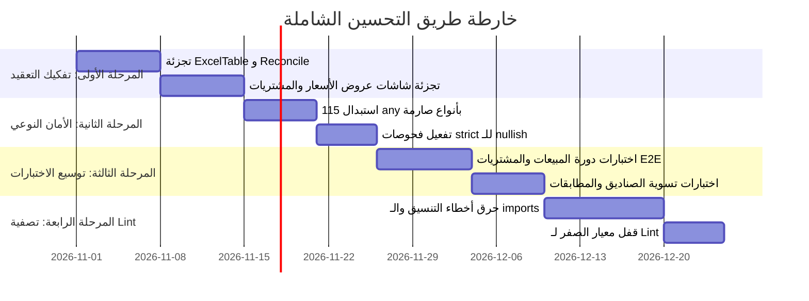

# 🚀 خطة التحسين والإصلاح المعمارية الشاملة لنظام الزهراء / الجعفري ERP
**تاريخ الإعداد:** 29 أكتوبر 2026  
**الحالة:** معتمدة للتنفيذ  
**النطاق:** الهندسة المعمارية، الأداء، الأمان النوعي، وتغطية الاختبارات  

---

## 🎯 الأهداف الاستراتيجية للخطة
1. **خفض التعقيد المكتبي (Decomposition):** تجزئة المكونات الكبرى (التي تقارب 800 سطر) إلى مكونات فرعية وهوكس مخصصة لمنع ثقل الرندر.
2. **الارتقاء بالأمان النوعي (100% Type Safety):** استبدال كافة استخدامات `any` الـ 115 بنماذج صارمة مستمدة من `database.types.ts`.
3. **رفع تغطية الاختبارات الحقيقية (Coverage Expansion):** رفع التغطية الفعلية من 12% إلى أكثر من 50% عبر اختبارات تكامل لتدفقات الدورة المستندية.
4. **تصفية الدين الفني لـ ESLint (Ratchet Burn-down):** حرق تدريجي لـ 9,478 تحذيراً/خطأ قديم عبر دفعات محددة دون تعطيل وتيرة التطوير.
5. **استدامة صحة قاعدة البيانات (Database Health & Reliability):** مراقبة دورية لنمو سجلات التدقيق `audit_logs` وضمان سلامة مهام `pg_cron`.

---

## 📅 مراحل التنفيذ (Implementation Roadmap)



---

## 🛠️ تفاصيل المراحل التنفيذية

### المرحلة 1: تفكيك المكونات عالية التعقيد (UI Complexity Decomposition)
* **الأولوية:** عالية جداً (P0)
* **الملفات المستهدفة:**
  1. `src/features/reconciliation/pages/DailyReconciliationPage.sections.tsx` (788 سطر):
     - فصل قسم الفئات النقدية في `DenominationSummarySection.tsx`.
     - فصل قسم فروقات الحسابات في `DiscrepancyBreakdownSection.tsx`.
     - عزل منطق الحسابات في `useReconciliationCalculations.ts`.
  2. `src/ui/common/ExcelTable.tsx` (792 سطر):
     - استخراج إدارة التحديد ولوحة المفاتيح في `useExcelKeyboardNav.ts`.
     - استخراج منطق التصدير والنسخ واللصق في `useExcelClipboard.ts`.
     - فصل ترويسة الجدول وتذييله في مكونات فرعية مستقلة.
  3. `src/features/sales/components/quotations/QuotationDetailsModal.tsx` (772 سطر):
     - استخراج شريط الإجراءات والتحويل إلى فاتورة في `QuotationActionFooter.tsx`.
     - فصل عرض الأصناف والخصومات في `QuotationItemsList.tsx`.

---

### المرحلة 2: الأمان النوعي وتصفية `any` (Type Safety & Null Safety)
* **الأولوية:** عالية (P1)
* **الإجراءات المحددة:**
  1. تشغيل ماسح الأنواع: `npm run scan:types` لحصر المواقع بدقة السطر والعمود.
  2. إحلال `Database['public']['Tables']['...']['Row']` محل أي كائن غير مقيد.
  3. استبدال `catch (err: any)` بنمط التحقق الآمن:
     ```typescript
     catch (err: unknown) {
       const appError = parseError(err);
       logger.error('Context', appError.message);
     }
     ```
  4. منع كاستينغ `as any` في استدعاءات الـ RPC وتحديث `database.helpers.ts`.

---

### المرحلة 3: التغطية الاختبارية لدورات العمل الحساسة (Integration Testing)
* **الأولوية:** متوسطة - عالية (P1)
* **المسارات المستهدفة:**
  1. **دورة المبيعات والمرتجعات:** اختبار تكامل متكامل يبدأ من مسودة الفاتورة -> الاعتماد -> الخصم المخزني -> القيد المالي -> إرجاع جزئي.
  2. **تسوية الصناديق متعددة العملات:** اختبار مطابقة صندوق الريال السعودي والريال اليمني وتطبيق سعر الصرف ومنع التضارب.
  3. **عزل الفروع والمستودعات:** اختبار منع مستخدم الفرع (B) من الوصول إلى قيود أو كشوفات الفرع (A) إلا بالصلاحيات الممنوحة.

---

### المرحلة 4: حرق ديون الـ Lint وآلية الترس (Ratchet Burn-down)
* **الأولوية:** مستمرة (P2)
* **الخطة الإجرائية:**
  - تقسيم الملفات بحسب المجلدات (`features/sales`, `features/accounting`, `features/inventory`).
  - تشغيل `pnpm run lint:fix` التلقائي لقواعد التنسيق والمستوردات غير المستخدمة.
  - خفض القيمة في `lint-total-baseline.json` بمقدار 1,500 خطأ لكل سبرنت وصولاً إلى صفر أخطاء.

---

### المرحلة 5: استدامة قاعدة البيانات والأداء السحابي (Database Operations)
* **الأولوية:** استباقية (P1)
* **الضوابط الدورية:**
  1. إدراج فحص `npm run check:db:health` كفحص أسبوعي مجدول عبر GitHub Actions.
  2. التحقق الدوري من وظائف `pg_cron` الخاصة بـ `VACUUM ANALYZE` للمحافظة على أداء الاستعلامات وسرعة الفهارس.
  3. استمرار منع تضخم جدول `audit_logs` ومراجعة حجم التخزين السحابي كل شهر.

---

## 📊 مؤشرات النجاح الرئيسية (KPIs)

| المؤشر | الوضع الحالي | المستهدف بعد التنفيذ |
| :--- | :---: | :---: |
| عدد الأسطر لأكبر ملف في المشروع | 792 سطر | ≤ 350 سطر |
| عدد استخدامات `any` في المشروع | 115 | **0** |
| أخطاء TypeScript | **0** | **0 (ثابت)** |
| نسبة النجاح في اختبارات الوحدة | 100% (1037/1037) | **100% (مع رفع التغطية لـ 50%+)** |
| رصيد أخطاء Lint التراكمية | 9,478 | **0** |
| زمن البناء الإنتاجي (Vite Build) | 23.4s | ≤ 20.0s |
